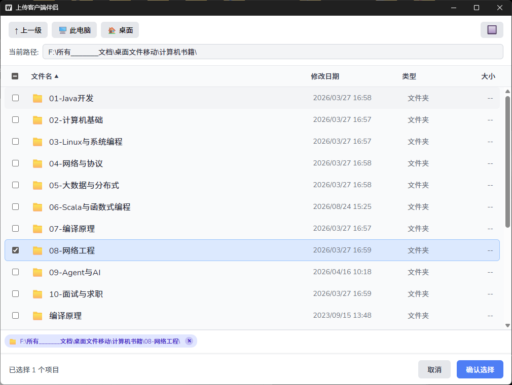
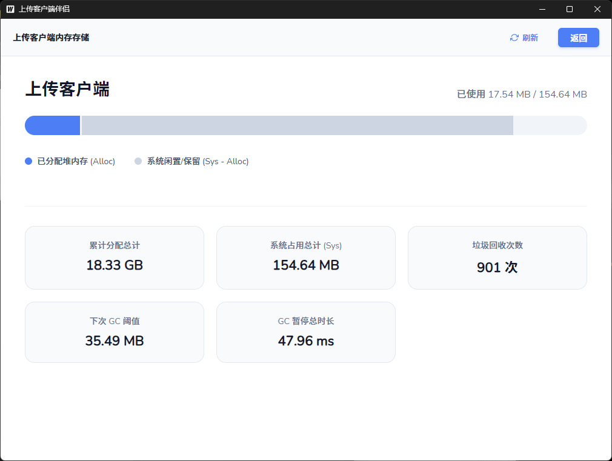
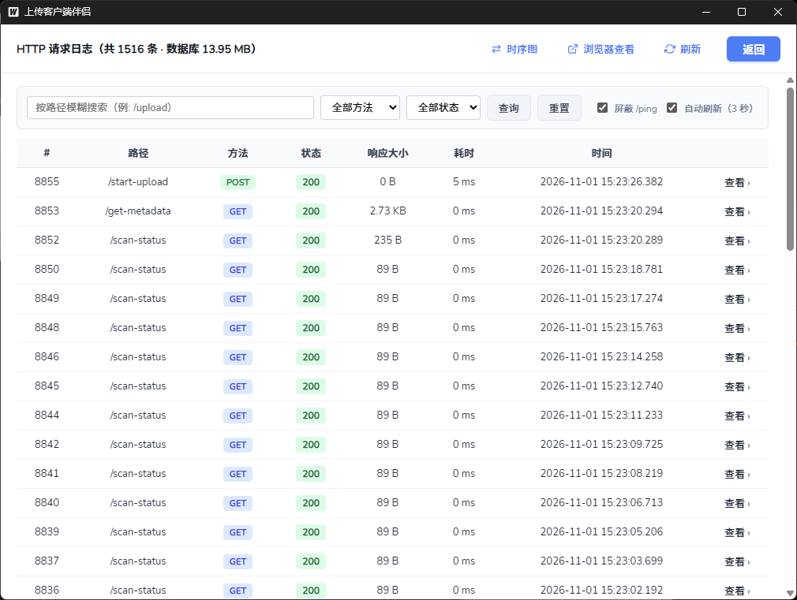
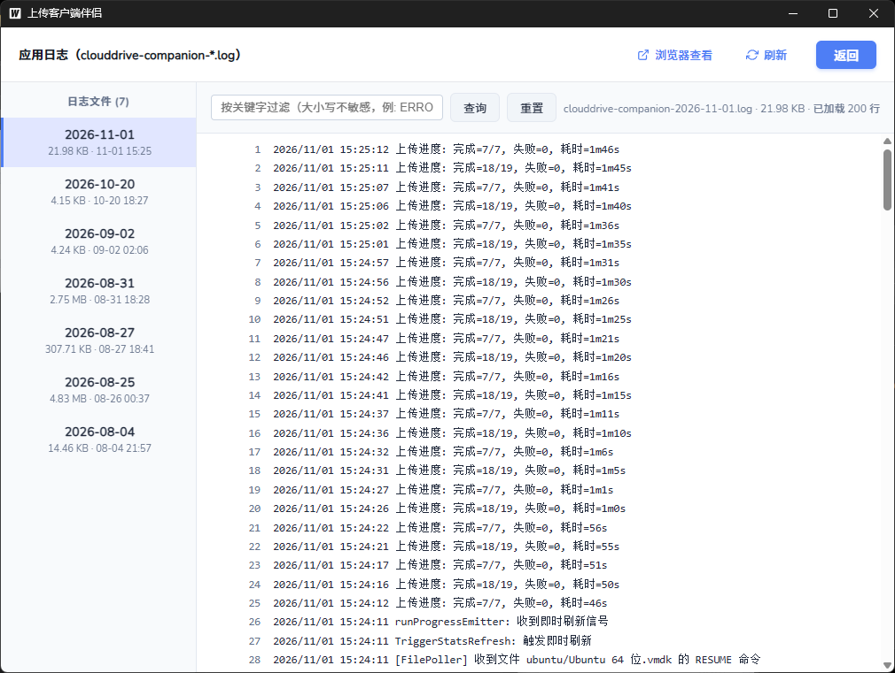
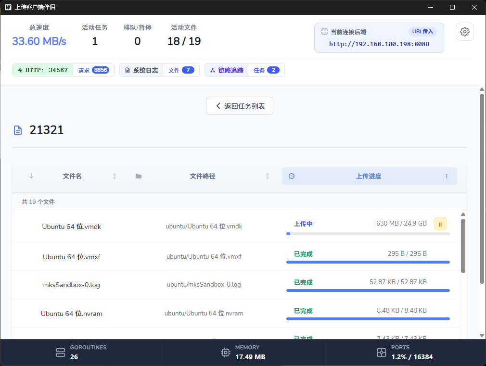
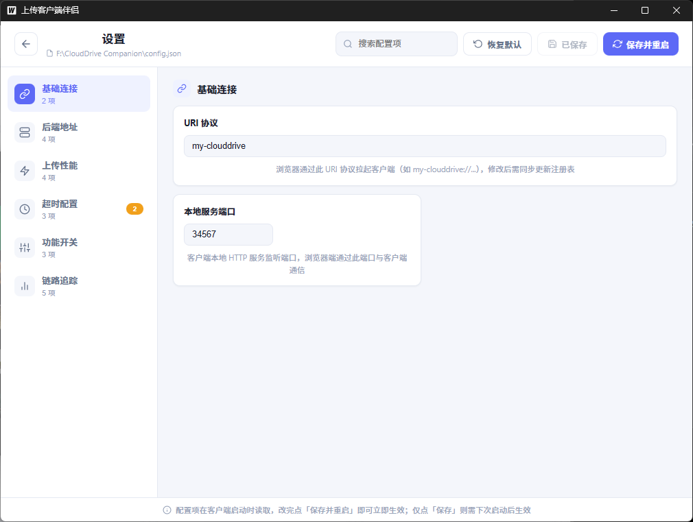
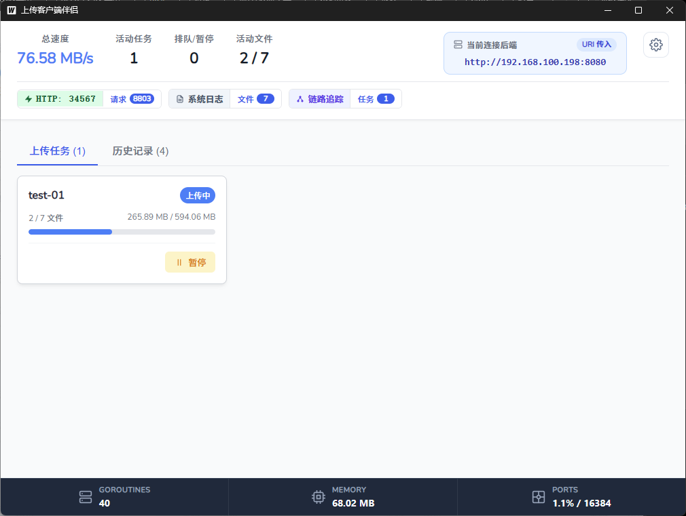
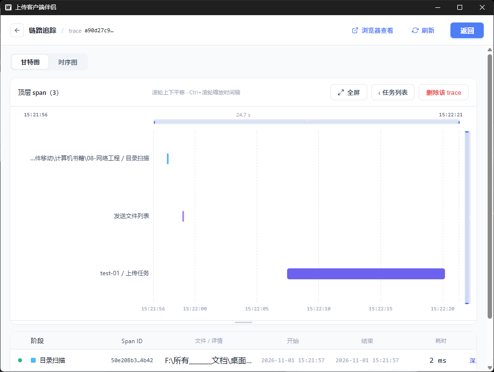
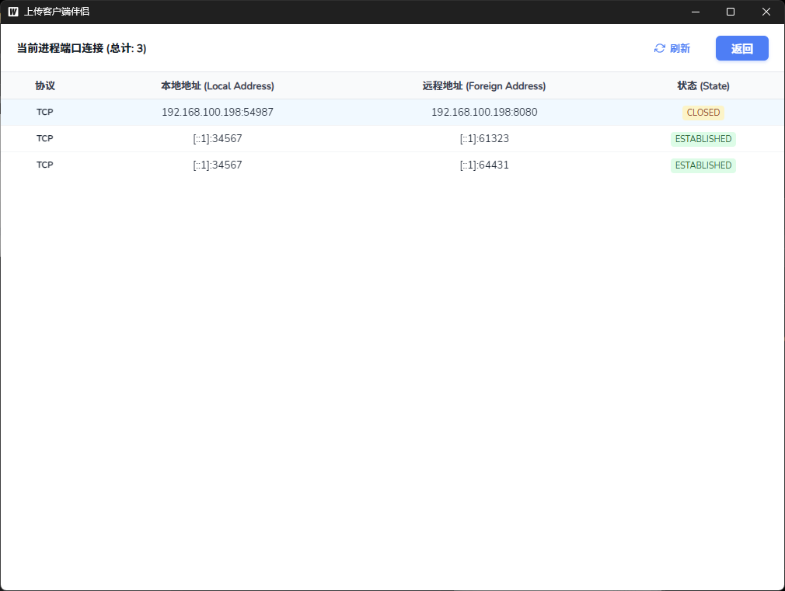
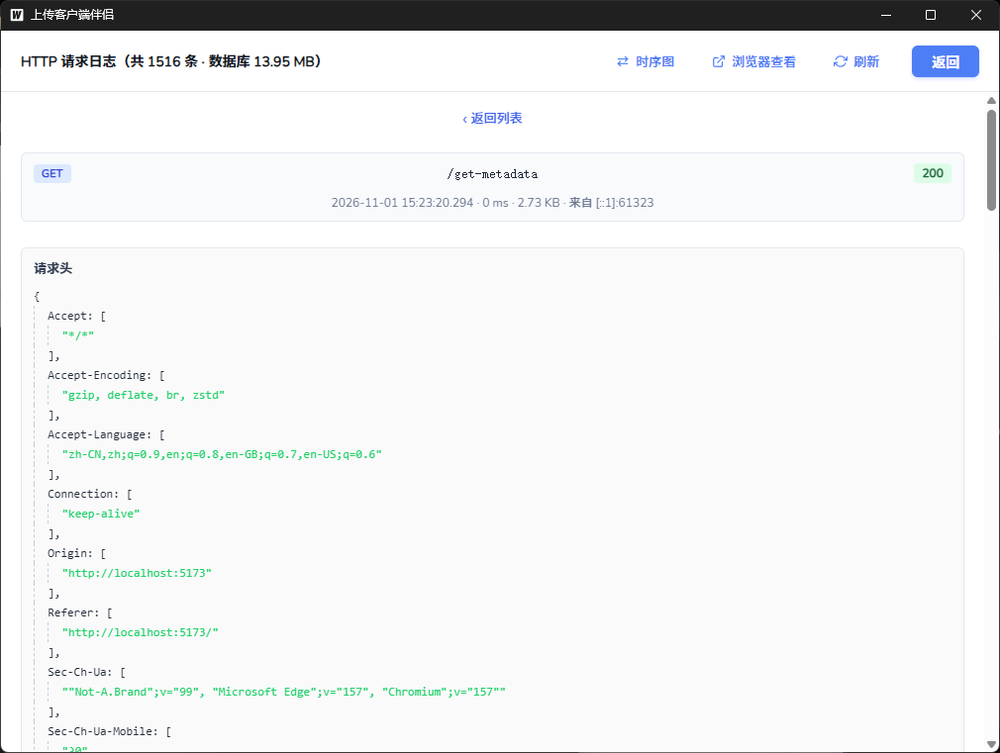

<div align="center">

# CloudDrive Companion

**A native desktop companion for web-based cloud drives — bring chunked upload with resume & real-time progress to any web app.**

云盘上传客户端伴侣程序 — 让网页端拥有本地大文件分片上传能力

[](https://github.com/kobaw23214/clouddrive-companion/stargazers)
[](LICENSE)
[](https://go.dev)
[](https://vuejs.org)
[](https://wails.io)
[](#)

**English** | [中文](#-简介)

</div>

---

## 🌐 What is this?

Browsers can't read local folders, and uploading multi-GB files from a web page is fragile: refresh the page and everything is lost. **CloudDrive Companion** is a tiny Windows desktop app (Wails2 + Go + Vue 3) that your web app launches via a custom URI scheme (`my-clouddrive://`). It opens a **native file/folder picker**, then uploads the selected files **directly to your backend** in concurrent chunks — with **automatic resume**, live SSE progress pushed back to the browser, and a system-tray resident client. Your web page just orchestrates; the heavy lifting happens natively.

```
Browser ──URI scheme──▶ Companion (native picker)
   ▲                        │
   └──── SSE progress ──────┘── chunked HTTP upload ──▶ Your backend
```

**Typical use cases:** private cloud drives, enterprise document systems, any web app that needs reliable multi-GB uploads on Windows.

---

## 📖 简介

CloudDrive Companion 是一个 Windows 桌面应用程序,用于辅助**网页端**进行大文件上传。它通过 URI Scheme 协议与浏览器通信:

- 📁 **自行实现的文件选择器** — 应用内文件列表浏览/勾选/筛选/全选,支持目录折叠;也可一键调起系统原生对话框
- 📤 **分片上传** — 大文件并发分片,支持 GB 级文件与**断点续传**
- 🔄 **实时进度** — 通过 SSE 把上传进度推回浏览器页面
- 🖥️ **系统托盘** — 后台常驻,关闭窗口即最小化到托盘
- 📊 **状态监控** — TCP 连接、端口占用、HTTP 请求日志、网络诊断一应俱全

## 🖼️ 界面截图

### 自行实现的文件选择器

<p align="center">
  
</p>

### 主面板与功能界面

| 上传任务 | 主面板与诊断 |
|:---:|:---:|
| <br>**上传任务面板** — 待续传/上传中/完成状态,批量暂停与重试 | <br>**主面板 Dashboard** — 网络状态 / 网络诊断 / 代理设置(上传流量是否走系统代理) |
| <br>**上传进度** — 分片进度/速度/状态一览 | <br>**HTTP 请求日志** — 逐请求查看 headers/body |
| <br>**扫描进度浮层** — 海量文件遍历实时反馈 | <br>**TCP 连接监控** — 含重试成功记录 |
| <br>**任务时序追踪** — 浏览器/客户端/后端全链路 | <br>**端口占用** — 监听端口与占用进程 |
| <br>**系统托盘** — 常驻后台快捷控制 | |

<details>
<summary>更多截图(端口连接明细、网络诊断页等)</summary>

| | |
|:---:|:---:|
| <br>**端口连接明细** | <br>**网络诊断** — 连通性/代理/DNS 测试 |

</details>

## ✨ 功能特性

- **URI Scheme 启动** — 浏览器通过 `my-clouddrive://` 协议唤起客户端(未运行时自动拉起)
- **大文件分片上传** — 并发分片,支持 GB 级文件
- **断点续传** — 分片进度落盘到 `tasks/` 目录,程序重启后从待续传列表恢复
- **追加选择(预选恢复)** — 浏览器回传上次已选文件列表,客户端恢复勾选状态;整目录自动折叠为一行显示
- **并发控制** — 智能限制并发数,防止端口耗尽
- **多地部署支持** — URI 携带 `server` 参数即可临时切换后端地址(仅内存生效,不写回配置)
- **窗口关闭即最小化到托盘**,不中断上传任务

## 🛠️ 技术栈

| 层级 | 技术 |
|------|------|
| 后端 | Go 1.21+ |
| 前端 | Vue 3 + Vite |
| 框架 | Wails v2 |
| UI 渲染 | WebView2 |
| 系统托盘 | systray |

## 🚀 快速开始

### 环境要求

- Go 1.21+ / Node.js 18+ / [Wails CLI v2](https://wails.io)
- Windows 10/11

```bash
# 安装 Wails CLI
go install github.com/wailsapp/wails/v2/cmd/wails@latest

# 开发模式(热重载)
wails dev

# 编译生产版本 → build/bin/clouddrive-companion.exe
wails build
```

### 创建安装包

1. 安装 [Inno Setup](https://jrsoftware.org/isinfo.php)
2. 编译 `setup_inno/go.iss` 生成安装包

## ⚙️ 配置说明

运行时配置 `config.json`:

```json
{
  "api_base_url": "http://your-backend:8080",
  "uri_scheme": "my-clouddrive",
  "listen_port": 34567
}
```

| 配置项 | 说明 | 默认值 |
|--------|------|--------|
| `api_base_url` | 后端 API 地址 | - |
| `uri_scheme` | URI 协议名称 | `my-clouddrive` |
| `listen_port` | 本地 HTTP 服务端口 | `34567` |

**WebView2 运行时**:优先使用系统安装版;若需离线部署,将 WebView2 Fixed Version 放入 `runtime/` 目录,程序启动时自动检测选择。

## 📡 API 接口

本地 HTTP 服务(默认端口 34567):

| 接口 | 方法 | 说明 |
|------|------|------|
| `/ping` | GET | 健康检查 |
| `/get-metadata` | GET | 获取已选择的文件元数据 |
| `/start-upload` | POST | 启动上传任务 |
| `/resume-upload` | POST | 恢复上传任务 |
| `/reselect` | POST | 重新选择文件;带 `preselect` body 时恢复上次已选列表(追加场景) |
| `/openClient` | POST | 显示客户端主面板 |
| `/pending-tasks` | GET | 获取待续传任务列表 |
| `/shutdown` | POST | 关闭程序 |

### 追加选择(预选恢复)

浏览器端保存用户上次确认的文件列表,用户点"追加"时把列表 POST 给客户端,客户端打开文件选择器并恢复勾选状态,用户补选后一起提交。

**设计要点:**

- **URI 不携带列表**:`my-clouddrive://select-files` 保持原样(URI 经命令行传递有 32KB 硬上限)。客户端未运行时先 URI 拉起,等 `/ping` 就绪后再 POST 列表
- **契约最小化**:`POST /reselect` 的 body 只需一组 `absolutePath` 字符串,其余字段客户端自行从磁盘获取
- **目录折叠**:某目录全部常规文件都在列表里时,恢复为"该目录被勾选"一行显示;已删除的文件进 `missing` 返回给浏览器提示

```json
// POST /reselect
{ "preselect": ["E:/docs/a.pdf", "D:/photos/IMG_001.jpg"] }

// 响应
{ "ok": true, "received": 1523, "dirs": [{ "path": "E:/docs", "fileCount": 1520 }], "fileCount": 2, "missing": [] }
```

## 🔗 URI Scheme

| URI | 说明 |
|-----|------|
| `my-clouddrive://select-files` | 启动程序并打开文件选择对话框 |
| `my-clouddrive://open-client` | 启动程序并直接显示主面板 |
| `my-clouddrive://close-client` | 关闭正在运行的客户端(幂等,无窗口闪现) |

### 通过 URI 传入后端地址(多地部署)

```
my-clouddrive://select-files?server=http://192.168.1.100:8081
my-clouddrive://open-client?server=https://backend.example.com:8443
```

- **URI 带 `server`** → 客户端仅**在内存中**使用该地址,优先级高于 `config.json`;进程退出即失效,不写回配置
- **URI 未带 `server`** → 沿用 `config.json`,与旧版完全兼容
- 浏览器拼接时记得对 `server` 值做 `encodeURIComponent` 编码

### close-client 的两级关闭策略

1. **优雅关闭**:调用运行实例的 `/shutdown`,轮询端口释放(最多 5 秒)
2. **强制兜底**:连不上或进程卡死时,回退 `taskkill` 结束进程树

> ⚠️ 关闭立即生效,**不等待进行中的上传任务**;未完成的分片进度已落盘,下次启动可恢复。

## 📁 项目结构

详细结构见 [PROJECT_STRUCTURE.md](./PROJECT_STRUCTURE.md),核心目录:

```
├── main.go          # 程序入口
├── internal/        # Go 后端核心模块(uploader / server / tracer / tray ...)
├── frontend/        # Wails 嵌入式前端(Vue 3)
├── setup_inno/      # Inno Setup 安装包脚本
└── testing/         # Chrome/Edge PNA 放行策略测试脚本
```

## 📝 License

MIT — 详见 [LICENSE](LICENSE)

> 如果这个工具帮到了你,欢迎点一个 ⭐ Star 让更多人看到

## 📬 联系我 / Contact

<div align="center">

**微信扫码交流 / Scan to chat on WeChat**

<a href="docs/contact/wechat-qrcode.jpg" target="_blank">
  
</a>

**邮箱 / Email**: [1477746214@qq.com](mailto:1477746214@qq.com)

</div>

---

<div align="center">

**如果这个项目帮到了你,欢迎点一个 ⭐ Star 支持一下!**

</div>
